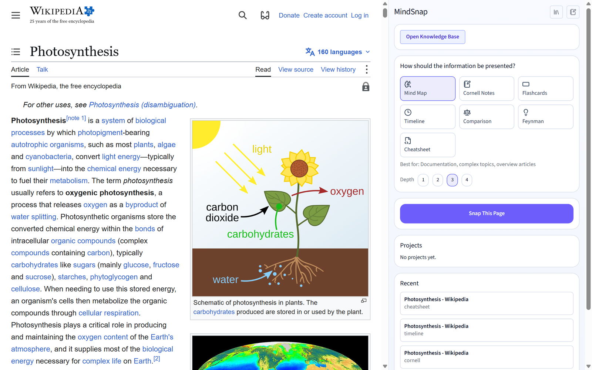
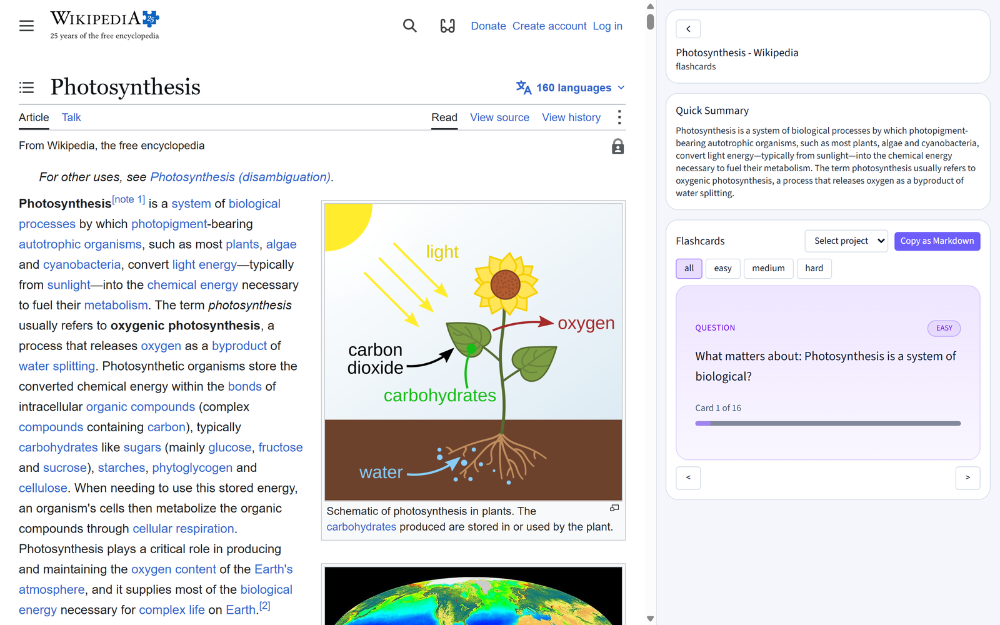
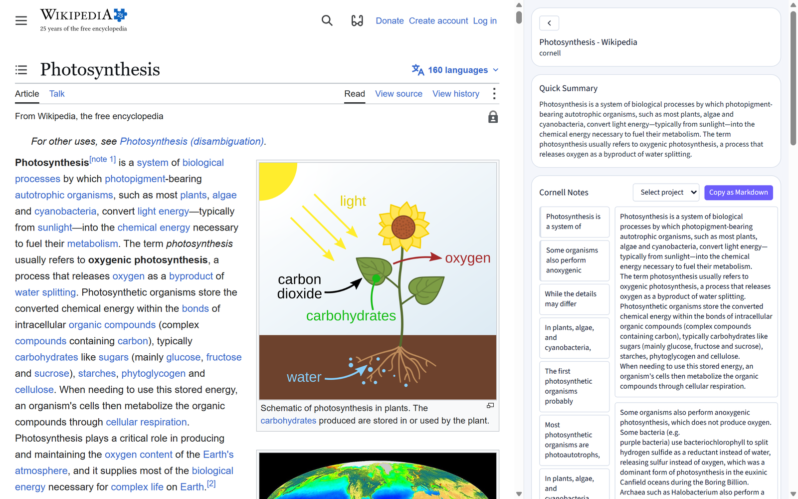
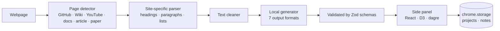

<div align="center">

# MindSnap

**Turn any webpage into a mind map, flashcards, Cornell notes or a cheatsheet — in one click, right in your browser.**

A Chrome extension that reads the page you're on and rebuilds it in the format
you actually study from. It runs entirely on your machine: no API keys, no
account, nothing leaves your browser.




</div>

---

## Why

Reading a long article, a Wikipedia page or a README is easy. Remembering it
is not. Copy-pasting into a chatbot means sending the page to someone else's
server, waiting, and then reformatting the answer yourself.

MindSnap does it in place: press **Ctrl+Shift+M**, pick a format, and the page
reappears in the side panel as something you can review, quiz yourself on, or
keep in a project.

## Seven ways to see a page

| Mode | What you get | Best for |
|---|---|---|
| 🧠 **Mind Map** | An interactive knowledge graph of the page's ideas | Documentation, complex topics, overview articles |
| 📝 **Cornell Notes** | Cues · Notes · Summary, the classic study layout | Lectures, articles, study materials |
| 🃏 **Flashcards** | Question → answer cards | Exam prep and memorization |
| ⏳ **Timeline** | Events in chronological order | History, biographies, roadmaps |
| ⚖️ **Comparison** | A side-by-side table | Reviews and trade-off analysis |
| 💡 **Feynman** | The topic explained in simple terms | Complex concepts and technical topics |
| ⚡ **Cheatsheet** | A compact operational playbook | APIs, syntax, formulas, workflows |

<table>
<tr>
<td></td>
<td></td>
</tr>
<tr>
<td align="center">Flashcards</td>
<td align="center">Cornell notes</td>
</tr>
</table>

<sub>Screenshots show the Wikipedia article <a href="https://en.wikipedia.org/wiki/Photosynthesis">Photosynthesis</a> (CC BY-SA 4.0).</sub>

## Features

- **One shortcut, any page.** `Ctrl+Shift+M` snaps the current page,
  `Ctrl+Shift+Y` opens MindSnap. Or right-click → *Snap with MindSnap* — on a
  whole page or just the text you selected.
- **Site-aware extraction.** Dedicated parsers for GitHub, Wikipedia, YouTube,
  documentation, articles and academic papers pull out headings, paragraphs
  and lists instead of navigation and ads.
- **Side panel workspace.** Results open next to the page, not in a new tab.
  Switch formats on the same snap without re-reading the page.
- **Projects and a knowledge base.** Save snaps, group them into projects,
  add your own notes, and browse everything you've collected.
- **Export and import.** Your whole library is one JSON file — back it up or
  move it to another browser.
- **English and Russian** interface.
- **Private by design.** Generation happens locally from the page content.
  The extension has no backend and makes no network calls with your data.

## How it works



| Layer | Where | What it does |
|---|---|---|
| Content script | `src/content/` | Detects the page type and extracts structured text with a matching parser |
| Service worker | `src/background/` | Routes messages, generates notes locally, stores and migrates data |
| Side panel | `src/sidepanel/` | Renders mind maps (D3 + dagre layout) and note views; projects and settings |
| Popup | `src/popup/` | The quick launcher on the toolbar |
| Shared | `src/shared/` | Types and schemas used on both sides of the message boundary |

## Install

### Download

1. Grab `mindsnap-<version>.zip` from the [latest release](https://github.com/omertaevalibekai/MindSnap/releases/latest) and unzip it.
2. Open `chrome://extensions` and turn on **Developer mode** (top right).
3. Click **Load unpacked** and choose the unzipped folder.

### From source

Requires Node.js 20+.

```bash
git clone https://github.com/omertaevalibekai/MindSnap.git
cd MindSnap
npm install
npm run build
```

Then load it into Chrome:

1. Open `chrome://extensions`.
2. Turn on **Developer mode** (top right).
3. Click **Load unpacked** and choose the `dist` folder.
4. Pin MindSnap to the toolbar, open any article and press **Ctrl+Shift+M**.

Works in Chrome and other Chromium browsers with side panel support
(Edge, Brave, Arc).

### Development

```bash
npm run dev     # Vite with hot reload for the extension (CRXJS)
npm run build   # type-check and production build into dist/
```

## Project layout

```
src/
  background/   service worker: message router, local generator, storage
  content/      page detection, site parsers, text cleaning, selection
  sidepanel/    React app: mind map canvas, note views, pages, stores
  popup/        toolbar popup
  shared/       types, schemas, constants
public/         icons and _locales (en, ru)
manifest.json   Manifest V3
```

## Roadmap

- [ ] Optional AI mode with a bring-your-own-key provider for richer notes
- [ ] Export to Markdown, Anki and PDF
- [ ] Spaced repetition for flashcards
- [ ] Chrome Web Store release

## Contributing

Issues and pull requests are welcome. Run `npm run build` before opening a PR
— it type-checks the whole project.

## License

[MIT](LICENSE)
